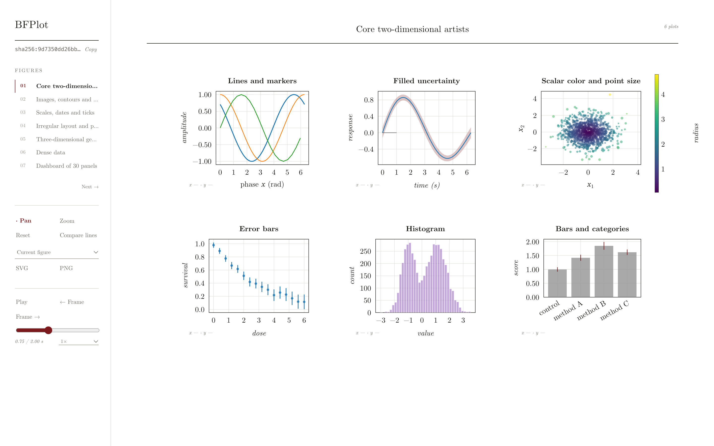
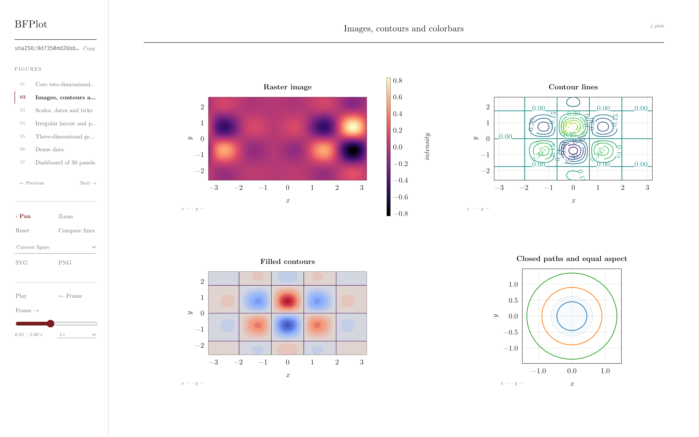
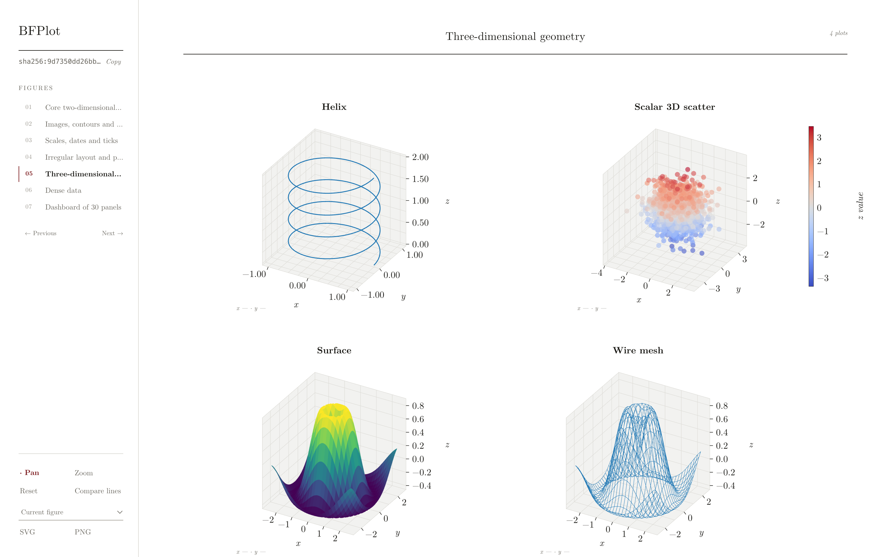
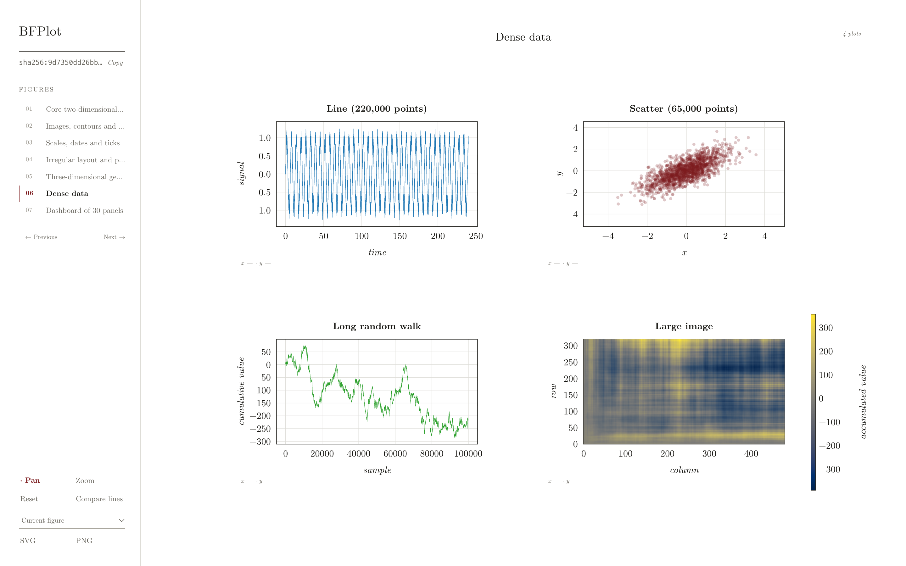

# BFPlot

> **[Read the documentation →](https://bfichera.github.io/bfplot/)**

Basically I was tired of saving `matplotlib` outputs as non-interactive static files. I also [hate jupyter notebooks](https://www.youtube.com/watch?v=7jiPeIFXb6U)! `bfplot` lets you save `matplotlib` figures:

```python
import matplotlib.pyplot as plt
import bfplot

fig, ax = plt.subplots()
ax.plot([1, 2, 3, 4], [1, 4, 9, 16], marker="o")

bfplot.savefig("my_plot.bfplot", fig)
```

in a format that you can open up and interact with later using an integrated viewer app:

```console
$ bfplot view my_plot.bfplot
```

Here's what the viewer looks like:



## Installation

Install the `bfplot` app, which has the viewer built in, on macOS or Linux:

```console
$ curl -LsSf https://github.com/bfichera/bfplot/releases/latest/download/install.sh | sh
```

Then install the Python interface (Python 3.10+) from GitHub:

```console
$ python -m pip install "bfplot @ git+https://github.com/bfichera/bfplot"
```

See [Installation](https://bfichera.github.io/bfplot/getting-started/installation/) for uninstalling and other options.

## Building from source

On other platforms, or to build everything yourself, you need:

- Python 3.10+ (pip 25.1+ if you want the development dependency groups)
- Rust 1.88+ (install with [rustup](https://rustup.rs))
- Node.js, only if you change the viewer

Clone the repository and install both parts into a virtual environment:

```console
$ git clone https://github.com/bfichera/bfplot.git
$ cd bfplot
$ python -m venv .venv
$ . .venv/bin/activate
$ python -m pip install --upgrade pip
$ python -m pip install ./crates/bfplot-cli -e .
```

`./crates/bfplot-cli` compiles the `bfplot` app with Cargo (through maturin) and installs it into the same environment as the Python library, where `bfplot.show()` finds it even if the environment is not activated. `-e .` installs the Python library in editable mode. Check both parts:

```console
$ python -c "import bfplot; print(bfplot.__version__)"
$ bfplot --version
```

To build only the app, without Python:

```console
$ cargo build --release --locked -p bfplot-cli
```

The binary is written to `target/release/bfplot`; copy it anywhere on your `PATH`.

For the development setup, tests and linters, see [Contributing](https://github.com/bfichera/bfplot/blob/main/CONTRIBUTING.md).

## Results

The code here: 

```python
with bfplot.result("results/fit.bfplot") as result:
    result.add(fig_spectrum, name="spectrum")
    result.add(fig_residuals, name="residuals")
```
produces a directory called `results/fit.bfplot` with the following structure:
```text
results/fit.bfplot/
├── manifest.toml
├── .gitignore
└── objects/
```

The `.gitignore` file keeps the data (in `objects/`) out of version control.

By default, `manifest.toml` ends with a rough ASCII/Braille drawing of each figure, written as `#` comments. It lets you see the plot in a diff or commit without opening the viewer. Pass `preview=False` to leave it out.

```toml
# Preview (approximate; regenerated on every save)
#
# ── calibration · Detector calibration ──────────────────────────────────
#  1.1┌──────────────── Response ─────────────────┐
#   s │⠐⠲⣄⡴⠒⠲⡄                         ⣠⠖⠂        │
#   i │ ⢠⠟⣆  ⠙⣆                      ⣰⠃          │
#   g │⢀⠏ ⠘⣆  ⠘⡆                   ⣰⠃            │
# -1.1└───────────────────────────────────────────┘
#     0                                         6.3
```

## Animations

```python
with bfplot.animation("wave.bfplot", fig, fps=30) as recording:
    for phase in np.linspace(0, 2 * np.pi, 180, endpoint=False):
        line.set_ydata(np.sin(x + phase))
        recording.capture()
```

## Hashes

Every result has one hash, recorded in its manifest. Two results have the same hash exactly when everything in them is identical.

```python
bfplot.hash("results/fit.bfplot")         # 'sha256:769fe097...'
bfplot.hash(fig)                           # the same figure, hashed without writing
bfplot.same("old/fit.bfplot", "new/fit.bfplot")
bfplot.verify("results/fit.bfplot")        # check every object, return the hash
```

```console
$ bfplot hash results/fit.bfplot
sha256:769fe0976cfeecf73414d7b467013c6cde561405bce6c5af5828836e03016e37
$ bfplot compare old/fit.bfplot new/fit.bfplot
different
  sha256:769fe097...  old/fit.bfplot
  sha256:45a78207...  new/fit.bfplot
figures[0].axes[0].title: "Tent" -> "Tall tent"
```

## Serving

`bfplot view` serves a result and opens it in your browser. `bfplot serve` does the same without opening a browser. By default the server listens on `127.0.0.1:8080`; use `--port` to change the port.

To serve remotely, bind to another address explicitly:

```console
$ bfplot serve my_plot.bfplot --bind 0.0.0.0 --port 9000
```

### Example: Using BFPlot with psana (SLAC S3DF)

On S3DF (`ssh <username>@s3df.slac.stanford.edu`, then to your psana node), start the server without a browser:

```console
$ bfplot serve /path/to/my_plot.bfplot --port 9000
```

On your own machine, forward the port through S3DF to the node running the server:

```console
$ ssh -L 9000:<psana-node>:9000 <username>@s3df.slac.stanford.edu
```

Then open <http://127.0.0.1:9000> in your local browser. If you run the server on the login node itself, use `localhost` in place of `<psana-node>`.

## Supported plots

Lines, scatter plots, images, error bars, filled regions, histograms, contours, text, patches and common 3D plots. Anything else is shown as a visible placeholder, never silently dropped.

To see them all, run the [example gallery](https://github.com/bfichera/bfplot/blob/main/examples/gallery.py): `python examples/gallery.py`, then `bfplot view gallery.bfplot`.

| Images, contours and colorbars | Three-dimensional geometry |
| --- | --- |
|  |  |

| Dense data |
| --- |
|  |

The first two gallery figures are independent animations: each has its own play button, timeline slider and frame rate, shown in the left rail while that figure is on screen.

## Security

Only open bfplot results from sources you trust.

## More

- [Contributing](https://github.com/bfichera/bfplot/blob/main/CONTRIBUTING.md)

## License

Apache License 2.0 or MIT License, at your option: [LICENSE-APACHE](https://github.com/bfichera/bfplot/blob/main/LICENSE-APACHE), [LICENSE-MIT](https://github.com/bfichera/bfplot/blob/main/LICENSE-MIT).
